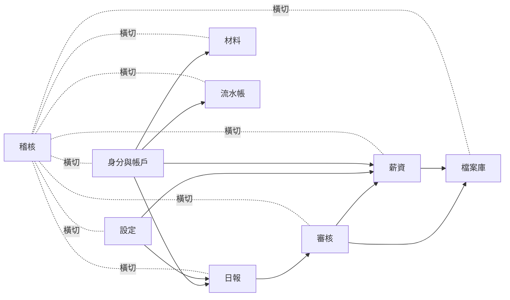

# 員工日報系統 — 行為規格

工程隊（瓦斯管線施工）用的工具：員工每日回報工項數量，管理員確認，系統依已確認的
回報計算薪資；另含材料庫存與申請、公司流水帳、日月報檔案庫，以及全程的權限檢查與
稽核紀錄。

**現況。** 系統尚未建置。這份規格是重建的基準：每個領域的行為目前都列在該領域的
「尚未建置」，建置它的 task 完成後才移到「情境」。基準來自 yc-daily-report-v3 的規格
（commit `e839d9d`，owner 已同意其中 13 條定義與 Q-001–Q-062 的決定）；與原文的每一處
差異列在 [`spec-baseline-diff.md`](../tasks/system-design/spec-baseline-diff.md)。

**來源。** Kuei 的決定 Q-001–Q-062，以及 Kuei 同意的 AD-1–AD-13（見
[`reference/appendix-e-decisions.md`](reference/appendix-e-decisions.md) 與
[`definitions.md`](definitions.md)）。

**讀者。** 看不到舊系統的實作者與驗證者。

共 9 個領域、31 個 feature、137 條規則、254 個 scenario、502 個例子（case：一般
scenario 算一個，Scenario Outline 的每一列算一個）。
<!-- spec-counts: features=31 rules=137 scenarios=254 cases=502 -->

## 領域

依「資料誰擁有、規則誰決定」切成 9 個領域。箭頭表示「需要對方的資料才能運作」。



| 領域 | 用途 | Feature | Scenario |
| --- | --- | --- | --- |
| [身分與帳戶](accounts/index.md)（IAM） | 讓每個人以自己的身分登入，並讓管理員管理帳戶、角色、密碼與每個人的薪資設定。 | 7 | 53 |
| [日報](reports/index.md)（RPT） | 讓員工回報每天完成的工項數量（可含共同作業者），並查詢與匯出自己的紀錄。 | 3 | 35 |
| [審核](review/index.md)（REV） | 讓管理員確認或駁回日報，確認時把數量分給作業小組的每個人並保存下來。 | 3 | 18 |
| [薪資](payroll/index.md)（PAY） | 依已確認的日報計算每個人的毛額、保留金與實發金額，保存成不會再變的薪資批次並匯出。 | 7 | 60 |
| [材料](materials/index.md)（MAT） | 讓員工申請材料、管理員審核，並維持庫存數字永遠對得起來。 | 4 | 36 |
| [流水帳](ledger/index.md)（LED） | 記錄公司的收入、支出與代墊，附上憑證檔案，並算出餘額。 | 2 | 18 |
| [稽核](audit/index.md)（AUD） | 每個動作都重新檢查權限，並把重要動作永久記錄下來供 owner 查閱。 | 2 | 12 |
| [檔案庫](archives/index.md)（ARC） | 每天與每月自動把已確認的日報存成檔案，也讓管理員手動產生、下載與刪除。 | 1 | 11 |
| [設定](settings/index.md)（CFG） | 讓管理員維護工項單價、未投保扣除比例、保留金費率與上限。 | 2 | 11 |

## 共用的文件

| 檔案 | 內容 |
| --- | --- |
| [`conventions.md`](conventions.md) | 規格的分層、scenario 寫作規約、結果類別、標籤 |
| [`background.md`](background.md) | 所有 scenario 共用的固定資料 |
| [`state-machines.md`](state-machines.md) | 回報、材料申請、流水帳紀錄、帳戶的狀態轉移 |
| [`definitions.md`](definitions.md) | 規格自行定義、owner 已同意的 13 條規則（AD-1–AD-13） |
| [`reference/appendix-a-catalogues.md`](reference/appendix-a-catalogues.md) | 工項目錄、預設單價、預設設定 |
| [`reference/appendix-b-fields.md`](reference/appendix-b-fields.md) | 欄位限制與錯誤字串 |
| [`reference/appendix-c-audit-types.md`](reference/appendix-c-audit-types.md) | 稽核類型 |
| [`reference/appendix-d-non-scenario.md`](reference/appendix-d-non-scenario.md) | 不寫成 scenario 的需求 |
| [`reference/appendix-e-decisions.md`](reference/appendix-e-decisions.md) | 決策索引 |
| [`reference/appendix-f-v2-map.md`](reference/appendix-f-v2-map.md) | v2 行為 ID 對照 |

## 名詞

Gherkin 只用下表的英文詞；說明文字用中文詞。每個詞只在這裡定義一次。

| 英文詞 | 中文 | 定義 |
| --- | --- | --- |
| unit | 只 | 工項數量單位，最小 0.1 |
| tenth | 0.1 只 | 內部整數計量單位；2.3 只等於 23 個 tenth |
| catalogue | 工項組 | `WEST`（32 項）、`SOUTH`（37 項）、`BIG_METER`（25 項），見附錄 A。回報送出時記下所屬工項組（AD-4）。 |
| crew | 作業小組 | 提交者加共同作業者，1–7 人，順序固定 |
| share | 份額 | 核准時存下來的每人數量 |
| payroll run | 薪資批次 | 一次薪資計算的不可變結果，含當時的單價、費率、上限（AD-1） |
| retention | 保留金 | 按只數預扣的金額，有年度上限 |
| payday-10 | 10 號發薪 | 會發固定薪資並扣勞健保的那一期 |
| uninsured deduction | 未投保扣除 | 未加保者按工項毛額比例扣除 |
| archived | 封存 | 帳戶不能登入，紀錄保留，可復原 |
| quarantine | 暫存區 | 匯入比對不一致的材料暫放處 |
| void | 作廢 | 流水帳紀錄保留但不計入合計 |

### 角色

| 角色 | 說明 |
| --- | --- |
| `OWNER` | 唯一一位（Kuei），系統建立時產生，不能封存、不能轉移。擁有 `ADMIN` 的全部權限，另可管理管理員與查看稽核紀錄。 |
| `ADMIN` | 管理員。審核回報與材料申請、計薪、管理 `USER` 帳戶、流水帳、檔案庫、設定。不填日報。 |
| `USER` | 員工。依施工區域（`WEST`、`SOUTH`）與大表旗標決定使用的工項組。 |
| `SYSTEM` | 排程與自動動作的行為者。 |

## 系統刻意不做的事

- 不寄電子郵件，也沒有「忘記密碼」自助流程；密碼由管理員重設。
- 不開放自行註冊；帳戶只能由管理員建立。
- 帳戶不會被刪除，只能封存與復原；`OWNER` 只有一位，不能封存、不能轉移。
- `USER` 看不到別人的銀行帳號、保險、扣除比例、保留金與薪資數字。
- 已計算的薪資批次不會因為之後改單價或費率而重算。
- 稽核紀錄不能被任何人修改或刪除。
- 不替使用者轉帳或付款；系統只產生薪資單、轉帳單與現金面額表。
- 規格不規定資料表、API 路徑、框架或部署方式。

## 檢查這份規格

```bash
python3 -m venv .venv
```

```bash
.venv/bin/pip install -r tools/requirements.txt
```

```bash
.venv/bin/python tools/check_spec.py
```

最後一行印出 `spec check: ok`，倒數第二行的總數與本頁上面的數字一致。
