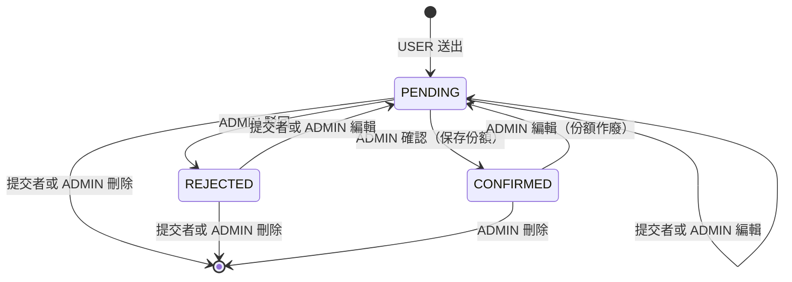

# 狀態機

每個合法轉移有一個 scenario，每個不合法轉移有一個拒絕 scenario。

## 回報

| 動作 | PENDING | CONFIRMED | REJECTED |
| --- | --- | --- | --- |
| 提交者編輯 | → PENDING | `FORBIDDEN` | → PENDING |
| 提交者刪除 | 刪除，額度釋放 | `FORBIDDEN` | 刪除，額度釋放 |
| 共同作業者編輯或刪除 | `FORBIDDEN` | `FORBIDDEN` | `FORBIDDEN` |
| ADMIN 確認 | → CONFIRMED | 略過 | 略過 |
| ADMIN 駁回 | → REJECTED | 略過 | 略過 |
| ADMIN 編輯 | → PENDING | → PENDING，寫 `REPORT_UNCONFIRM` | → PENDING |
| ADMIN 刪除 | 刪除 | 刪除 | 刪除 |

規則見 `reports/RPT-F02-report-lifecycle.feature` 與 `review/REV-F01-confirm-or-reject-reports.feature`。

## 材料申請

`PENDING → APPROVED`（庫存足夠）、`PENDING → REJECTED`、`PENDING → 取消並刪除`（只限申請人）。`APPROVED` 與 `REJECTED` 是終態，任何再審核都是 `CONFLICT`。

## 流水帳紀錄

`ACTIVE → VOIDED`（任何紀錄）、`ACTIVE → 刪除`（只限從未有過證據檔的紀錄）。`VOIDED` 是終態：不能編輯、沖銷、再作廢或取消作廢。

## 帳戶

`ACTIVE ⇄ ARCHIVED`。`OWNER` 帳戶沒有 `ARCHIVED` 狀態。登入鎖定是 `ACTIVE` 上的暫時旗標，不是獨立狀態。封存時該帳戶現有的 session 立即失效（AD-13）。
