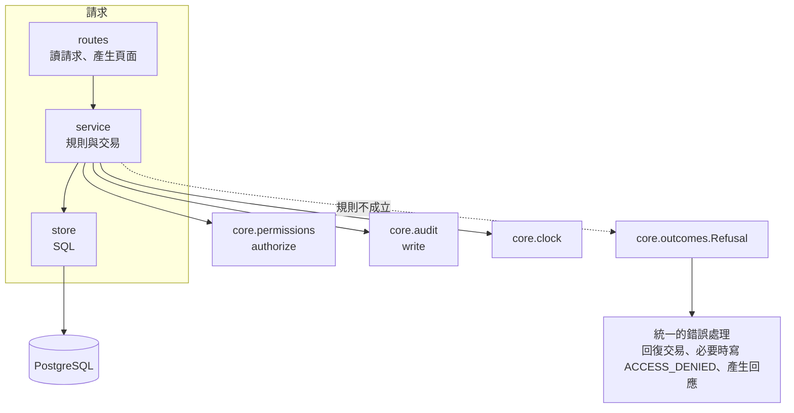
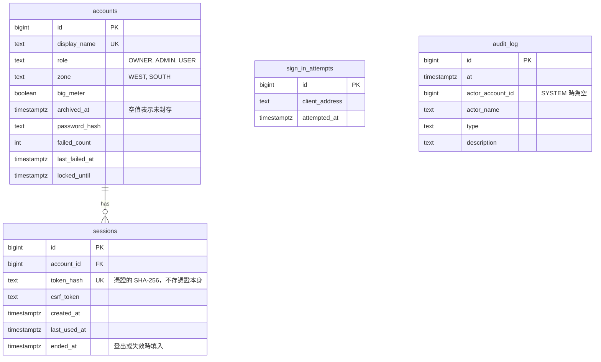

# 設計：skeleton-and-sign-in（骨架與登入）

系統層級的設計在 [`../system-design/design.md`](../system-design/design.md)；這份文件把
其中第 3、4、6 節的共同約定定成可以照著寫的介面，並加上登入這條路徑的細節。之後的
task 使用這裡定下的介面；要改介面時先改這份文件並在 trail 記一列。

名稱以英文寫，因為它們就是程式裡的名稱。

## 1. 形狀



本 task 建立的套件：

```text
app/
  __main__.py        指令入口：migrate、serve、check-config、create-owner、seed-demo
  main.py            create_app(settings, clock)；自動載入各領域的 routes
  core/
    config.py        Settings、load_settings
    clock.py         Clock、SystemClock
    db.py            連線池、transaction、每個請求一條連線
    migrate.py       套用 migrations/ 下的 SQL
    outcomes.py      Outcome、Refusal、錯誤處理
    permissions.py   Actor、authorize、動作的登記
    audit.py         write、SYSTEM
    web.py           樣板、共用版型、目前登入者的取得
    templates/       base.html、error.html
    static/          htmx（固定版本，附雜湊）
  accounts/          登入、session、登出（routes、service、store、templates）
  reports/           日報頁的空殼（只有 routes 與一個樣板）
  review/            確認頁的空殼
  system/            /health 與 /status
migrations/          0001_….sql
tests/
  conftest.py        資料庫叢集、範本資料庫、應用程式與時鐘的 fixture
  support/           recorder、規格解析、依規則開啟的 plugin
  implemented_rules.txt
  test_spec.py       執行 docs/spec 的 feature
  steps/common/      全部領域共用的步驟
  steps/accounts/、steps/audit/
  unit/
  browser/           Playwright 冒煙測試
```

## 2. 設定（`core/config.py`）

`load_settings(environ) -> Settings`：一次讀完，把所有問題收集起來後丟出一個
`ConfigError`，訊息逐項列出缺少或不合法的設定名稱。程式的其他地方不讀環境變數。

| 名稱 | 內容 | 缺少或不合法時 |
| --- | --- | --- |
| `DATABASE_URL` | PostgreSQL 連線字串 | 拒絕啟動 |
| `APP_ENV` | `development`、`test`、`production` | 預設 `development`；其他值拒絕啟動 |
| `PASSWORD_HASH_PROFILE` | `standard` 或 `fast` | 預設 `standard`；`production` 搭配 `fast` 拒絕啟動 |
| `TRUSTED_PROXY_HOPS` | 0 以上的整數 | 預設 0 |
| `CLOCK_OFFSET_MINUTES` | 整數；把系統時鐘往後撥，手動試逾時用 | 預設 0；`production` 下不為 0 拒絕啟動 |
| `STORAGE_BACKEND`、`BANK_KEY` | 本 task 只讀「有沒有設定」，供 `/status` 顯示 | 視為未設定，不是錯誤 |

與系統設計 9.3 的差別：不需要 `SESSION_SECRET`。登入憑證與防偽造憑證都是伺服器產生
的隨機值、存在資料庫，沒有任何東西需要簽章。少一把要保管的金鑰。

## 3. 時鐘（`core/clock.py`）

```python
TAIPEI = ZoneInfo("Asia/Taipei")

class Clock(Protocol):
    def now(self) -> datetime: ...        # 一律帶時區，時區是 Asia/Taipei

class SystemClock:                         # 建構時可給 offset（CLOCK_OFFSET_MINUTES）
    def now(self) -> datetime: ...
```

`create_app(settings, clock)` 把時鐘放在 `app.state.clock`；服務函式由參數取得時鐘。
測試用的時鐘（可設定、可往後撥）放在 `tests/`。有一個測試掃描 `app/` 的原始碼：
除了 `core/clock.py` 以外，出現 `datetime.now`、`datetime.utcnow`、`date.today`、
`time.time` 或 SQL 的 `now()`、`current_timestamp` 就失敗。寫進資料庫的時間一律由
程式傳入，不用資料庫的時間函式。

## 4. 資料庫與交易（`core/db.py`、`core/migrate.py`）

- psycopg 3 的連線池。路由一律是同步的 `def`（FastAPI 會放到執行緒池），不寫
  `async def` 路由：v3 在 `async` 路由裡呼叫同步資料庫與密碼雜湊，卡住了整個行程。
  只讀請求內容、不碰資料庫也不做雜湊的相依函式可以是 `async`（讀表單就是）。
- 每個請求一條連線、一個交易：請求處理成功就提交，丟出例外就回復。服務函式不自己
  提交。
- Migration 是 `migrations/NNNN_name.sql`，只往前。`schema_migrations` 記錄版本、檔名、
  雜湊與套用時間；已套用的檔案內容被改過就拒絕繼續。套用時先取得一個 advisory lock，
  多個行程同時啟動也只會套用一次。
- `python -m app serve` 先套用 migration 再啟動伺服器；migration 失敗就不啟動。
- 待套用的檔案編號若比已套用的還小，`migrate` 會拒絕。並行的 ticket 與 task 新增
  migration 時，後合併的那一個要把編號改到最後。

## 5. 拒絕（`core/outcomes.py`）

```python
class Outcome(Enum):          # 名稱與 HTTP 狀態來自 docs/spec/conventions.md
    UNAUTHENTICATED, FORBIDDEN, INVALID, CONFLICT, LOCKED, RATE_LIMITED, BLOCKED
    status: int               # 401、403、422、409、423、429、409
    # 狀態碼是屬性而不是列舉的值：CONFLICT 與 BLOCKED 都是 409，
    # 用值的話 Python 會把兩者併成同一個成員。

class Refusal(Exception):
    def __init__(self, outcome: Outcome, message: str, *, attempted: str | None = None): ...
    # attempted：被拒絕的動作名稱；FORBIDDEN 時寫進 ACCESS_DENIED 的說明
```

規則不成立時只有一種做法：`raise Refusal(...)`。統一的錯誤處理依序：

1. 回復這個請求的交易。
2. `FORBIDDEN` 而且有登入者：另開一個交易，只寫一列 `ACCESS_DENIED`（行為者是登入
   者，說明含 `attempted`）。
3. 產生回應：狀態碼是 `outcome.status`，標頭 `X-Outcome` 是類別名稱。請求的 `Accept`
   含 `application/json` 時，主體是 `{"outcome": "...", "message": "..."}`；否則是
   頁面，訊息放在 `role="alert"` 的元素裡。

`UNAUTHENTICATED` 而且請求要的是 HTML 時（不論方法），主體就是登入頁本身，狀態碼仍是
401：使用者看到登入頁與訊息，測試看到 401。錯誤處理以 `outcomes.install(app, page)`
安裝；`page` 是把拒絕畫成頁面的函式，由 `core/web.py` 以樣板提供。

「找不到」不是結果類別：回 404，不寫稽核（brief 假設 3）。

不只是 `Refusal`：任何狀態碼 400 以上的回應都會回復這個請求的交易。要寫 `ACCESS_DENIED`，
錯誤處理需要知道登入者是誰，所以解析登入狀態的那一段必須把登入者放在
`request.state.actor`。

錯誤字串只有一個來源：`docs/spec/reference/appendix-b-fields.md`。有一個測試確認
`app/` 裡每一個 `Refusal` 的訊息都逐字出現在附錄 B。

## 6. 權限（`core/permissions.py`）

```python
@dataclass(frozen=True)
class Actor:
    account_id: int
    name: str
    role: Literal["OWNER", "ADMIN", "USER"]

def permission(action: str): ...           # 裝飾器：登記一個動作的判斷函式
def authorize(actor: Actor, action: str, resource: object | None = None) -> None: ...
```

每個領域在自己的套件裡登記它的動作，例如 `reports.open_form`。判斷函式拿到登入者與
對象，回傳是否允許。`authorize` 在沒有登記這個動作、或判斷函式沒有明確回傳允許時，
一律 `raise Refusal(FORBIDDEN, "禁止存取", attempted=action)`。

本 task 登記的動作只有空殼頁與狀態頁：`reports.open`（`USER`）、`review.open`
（`ADMIN`、`OWNER`）、`system.status`（`ADMIN`、`OWNER`）。規格 AUD-R02 的權限總表與
AUD-R03 留到 Task 8 才開啟；本 task 以單元測試證明機制（未登記的動作被拒絕、被拒絕
時剛好多一列 `ACCESS_DENIED`、其他資料不變）。

## 7. 稽核（`core/audit.py`）

```python
SYSTEM = ...                                # 自動動作的行為者
def write(conn, clock, actor: Actor | SYSTEM, type: str, description: str) -> None: ...
```

- `type` 必須是 `docs/spec/reference/appendix-c-audit-types.md` 列出的類型；程式裡以
  常數表示，並有測試確認常數與附錄 C 一致。
- 成功的動作：呼叫者把自己的連線傳進來，稽核列與資料變更在同一個交易。
- 稽核表記錄行為者的帳戶 id（`SYSTEM` 時為空）與當時的顯示名稱。
- 不可修改：資料庫的 trigger 擋掉對稽核表的 `UPDATE`、`DELETE`、`TRUNCATE`。這與
  資料庫角色的權限無關，所以連應用程式自己也改不了。

## 8. 資料（`migrations/0001`）



`audit_log` 在 migration `0001`，`accounts` 與 `sessions` 在 `0002`，`sign_in_attempts` 在
`0003`。

約束：顯示名稱唯一；角色與區域的檢查約束；大表旗標只能在 `USER` 上；`OWNER` 不能有
`archived_at`；部分唯一索引保證只有一位 `OWNER`；`failed_count >= 0`。帳戶表只放本
task 用得到的欄位，薪資設定等欄位由 Task 4 以新的 migration 加上。

封存用時間而不是布林：規格 PAY-F03 之後需要知道封存發生在哪一個計薪期間。

## 9. 登入、session 與登出（`accounts/`）

### 9.1 網址

| 方法與路徑 | 用途 | 誰可以 |
| --- | --- | --- |
| `GET /` | 依登入狀態轉到落地頁或登入頁 | 任何人 |
| `GET /sign-in` | 登入頁；已登入者被帶到自己的落地頁 | 任何人 |
| `GET /sign-in/names?group=` | 該群組的名單（頁面片段） | 任何人 |
| `POST /sign-in` | 登入 | 任何人 |
| `POST /sign-out` | 登出 | 已登入 |
| `GET /reports` | 日報頁（空殼） | `USER` |
| `GET /review` | 確認頁（空殼） | `ADMIN`、`OWNER` |
| `GET /health` | 給平台的健康檢查：資料庫連得上回 200，否則 503；不含細節 | 任何人 |
| `GET /status` | 資料庫、檔案儲存、加密金鑰、migration 版本的狀態 | `ADMIN`、`OWNER` |

落地頁：`USER` 是 `/reports`，`ADMIN` 與 `OWNER` 是 `/review`。

### 9.2 登入的判斷順序

1. **頻率限制**（IAM-R07）。以來源位址取得該位址的 advisory lock（交易層級），數最近
   60 秒內這個位址的嘗試紀錄；已有 10 筆就 `RATE_LIMITED`「登入嘗試過於頻繁，請稍後
   再試」，而且這一次不記錄；否則記下這一次嘗試。因為計數在資料庫、而且先鎖再數，
   多個行程與重啟後都成立。
2. **欄位**。群組可以不帶（介面一律會帶）；帶了卻不是 `admin`、`west`、`south` 就
   `INVALID`「請選擇類型」。沒有帳戶名稱，或有帶群組而該名稱不在這個群組的名單內，
   `INVALID`「請選擇帳戶」。
3. **帳戶**。名稱不存在或帳戶已封存：先對一個固定的假雜湊做一次密碼驗證（讓回應
   時間與真的帳戶相近），再 `UNAUTHENTICATED`「密碼錯誤，請重試」。
4. **鎖定**（IAM-R04）。鎖住這個帳戶列。`locked_until` 還沒到：`LOCKED`「密碼錯誤
   次數過多，請在 15 分鐘後再試」，不驗證密碼、不計次、不延長鎖定。`locked_until`
   已到（剛好 15 分鐘整也算已到）：清掉鎖定並把次數歸零。
5. **安靜期**（IAM-R05）。距離上一次失敗已滿 15 分鐘：次數歸零。
6. **密碼**。錯誤：次數加一並記下時間；這是第 5 次就設定 `locked_until` 為 15 分鐘
   後、寫一列行為者為 `SYSTEM` 的 `ACCOUNT_LOCKOUT`，回 `LOCKED`；否則回
   `UNAUTHENTICATED`「密碼錯誤，請重試」。正確：次數歸零，建立 session，轉到落地頁。

失敗的登入必須把計數寫進資料庫，所以登入的服務函式在丟出拒絕之前先提交計數：
它用自己的交易處理計數，不依賴「拒絕就整個回復」。這是全系統唯一的例外，寫在這裡
是為了讓之後的人知道它是刻意的。

來源位址：`TRUSTED_PROXY_HOPS` 為 0 時取連線的對端位址；為 n 時取 `X-Forwarded-For`
從右邊數來第 n 個。不信任使用者自己放進去的更左邊的值（v2 的缺陷）。

### 9.3 Session

- 登入成功時產生兩個隨機值：登入憑證（放在 cookie `session`）與防偽造憑證（放在
  頁面上）。資料庫只存登入憑證的 SHA-256。
- Cookie：`HttpOnly`、`SameSite=Lax`、路徑 `/`、沒有 `Max-Age` 與 `Expires`（關掉
  瀏覽器就消失，沒有「記住我」）；`APP_ENV=production` 時加上 `Secure`。
- 取得目前登入者：以 cookie 找到未結束的 session；`last_used_at` 加 30 分鐘小於等於
  現在就是逾時（剛好 30 分鐘整也算逾時），標記結束並當作未登入；帳戶已封存也當作
  未登入。否則把 `last_used_at` 更新為現在。只有這個函式會延長閒置時間。
- 一個人可以同時有多個 session，各自計算閒置時間。
- 登出：把這個 session 標記結束，清掉 cookie，顯示登入頁與「您已登出」。
- 未登入而要求受保護的頁面或動作：`UNAUTHENTICATED`「請重新登入」，不寫稽核
  （AUD-R01）。

### 9.4 防偽造

有登入狀態、而且方法不是 `GET` 或 `HEAD` 的請求，必須帶著這個 session 的防偽造憑證：
放在標頭 `X-CSRF-Token`（共用版型以 `hx-headers` 統一加上），或表單欄位
`csrf_token`（給不經過 HTMX 的一般表單，例如登出）。沒有或不符：
`Refusal(FORBIDDEN, "請求未通過驗證", attempted=方法與路徑)`，因此會寫一列
`ACCESS_DENIED`（IAM-R12）。檢查寫在一處（共用的相依函式），各頁不需要自己記得。

`POST /sign-in` 沒有登入狀態，不檢查；`SameSite=Lax` 已經擋掉跨站送出的表單帶上
cookie。

### 9.5 密碼雜湊

argon2id（`argon2-cffi`）。`standard` 用套件的預設參數；`fast` 用最低成本的參數，
只給測試用，正式環境拒絕。雜湊字串自己帶著參數，之後調高參數不影響舊密碼的驗證。

## 10. 指令（`python -m app …`）

| 指令 | 做什麼 |
| --- | --- |
| `check-config` | 讀設定並印出每一項的狀態；有問題時以非零狀態結束 |
| `migrate` | 套用尚未套用的 migration |
| `serve` | `migrate` 之後啟動伺服器 |
| `create-owner` | 問顯示名稱與密碼（密碼不顯示、輸入兩次），建立唯一的 `OWNER`；已有 `OWNER` 時拒絕。密碼不接受命令列參數，所以不會留在 shell 的歷史紀錄 |
| `seed-demo` | 載入規格共用背景的 9 個帳戶與固定的示範密碼；`production` 下拒絕 |

## 11. 測試骨架

### 11.1 資料庫

測試需要一個可以建立資料庫的 PostgreSQL。設了 `TEST_DATABASE_URL` 就用它（CI 用
服務）；沒設就由 fixture 自己用 `initdb`、`pg_ctl` 起一個拋棄式的叢集（在暫存目錄、
隨機的空埠；以 root 執行時改用 `postgres` 這個系統使用者），測試結束後移除。

整個測試階段先建一個套好 migration 的範本資料庫；每個測試從範本複製出自己的資料庫
（`CREATE DATABASE … TEMPLATE …`），結束後丟掉。不用「清空資料表」：稽核表擋掉了
`TRUNCATE`，而且並行的測試需要真的多條連線，放在一個會回復的交易裡做不到。

### 11.2 規格的 feature 直接執行

- pytest-bdd，`bdd_features_base_dir = docs/spec`；`tests/test_spec.py` 收進全部 31
  個 feature。
- `tests/implemented_rules.txt` 一行一個規則 ID。收集測試時，規則不在清單上的
  scenario 被標成略過，原因是「尚未建置：<規則 ID>」；在清單上的照常執行，缺步驟
  就是失敗。
- 一個測試確認收集到的例子總數等於 `tools/check_spec.py` 算出的 502：pytest-bdd 會
  無聲地丟掉同名的 scenario，這個測試會抓到。
- 一個測試確認清單上的每個 ID 都真的存在於規格，而且清單沒有重複。

本 task 結束時清單上有 11 條：IAM-R01 至 R07、IAM-R10 至 R12、AUD-R01。

### 11.3 共用步驟是公開介面

`tests/steps/common/` 的步驟給全部領域用。寫之前先把 31 個 feature 裡所有步驟文字
列出來，找出跨領域重複的句型，一次設計完；之後的 task 只能新增，不能改既有步驟的
意義。至少包含：

| 句型 | 意義 |
| --- | --- |
| `the clock is "<時刻>" in Asia/Taipei` | 設定測試時鐘。撥動時間的說法在規格裡都只出現在單一領域，所以由各領域自己的步驟呼叫 `world.clock.advance`，不做成共用步驟 |
| `"<名字>" is signed in` | 以該帳戶建立登入狀態，之後的請求帶著它 |
| `the request is rejected as <類別>` | 狀態碼與 `X-Outcome` 都符合 |
| `… with message "<訊息>"` | 回應的訊息逐字相同 |
| `the outcome is <結果>` | `accepted` 或一個結果類別；各領域可以登記自己的成功說法（例如 `signed in`） |
| `nothing is written` | 動作前後全部資料表的快照相同 |
| `an audit row "<類型>" is written with actor <行為者>` | 動作之後剛好多出這一列 |
| `nothing else is written`、`nothing is written except an audit row …` | 除了前面斷言過的稽核列，快照沒有其他差異 |
| `no audit row is written` | 稽核表沒有多出任何列 |

快照比對忽略一個明確列出的清單：`sessions.last_used_at`（每個帶登入狀態的請求都會
更新它，這不是規格說的「寫入」）。清單寫在 recorder 的原始碼裡，新增項目算是設計
變更。

固定資料從 `docs/spec/background.md` 的表格解析出來，不另外抄一份。

### 11.4 三個層級

- 單元測試（`tests/unit/`）：`core` 的每個約定。
- 規格的 scenario：以同一個行程內的 HTTP 請求執行（`Accept: application/json`，直接
  讀類別與訊息）。
- 瀏覽器冒煙測試（`tests/browser/`）：用這個環境已安裝的 Node 版 Playwright 與
  Chromium，對真的啟動起來的伺服器走一次「選群組、選名字、登入、看到落地頁、登出」。
  由 pytest 的一個測試啟動伺服器並執行 Node 腳本。找不到 Node 或 Playwright 時略過
  並印出原因；設了 `REQUIRE_BROWSER=1`（CI 會設）時改為失敗。

### 11.5 並行

IAM-R07 的 `@concurrency` scenario 用真的多條連線同時送出，而且要在拿掉 advisory
lock 之後每次都失敗；builder 要實際拿掉、重複執行，並把結果寫進 Ready 留言。

## 12. 衡量過的第二種做法

| 決定 | 另一種做法 | 為什麼沒選 |
| --- | --- | --- |
| Session 存在資料庫 | 簽章的無狀態 cookie | 登出要立即生效、之後封存帳戶要立即踢掉（AD-13），無狀態做不到；多一把簽章金鑰 |
| 依規則開啟的清單檔 | 在 feature 檔上加「未完成」標籤 | 建置狀態會寫進規格檔，每個 task 都要改規格的原文 |
| pytest-bdd | behave | behave 對 `Rule` 與標籤的支援較直接，但它自成一套執行環境，不能與單元測試共用 fixture；v3 已經把 pytest-bdd 的兩個坑（同名 scenario、全域步驟）踩出來，這裡有對應的防護 |
| 每個測試一個從範本複製的資料庫 | 在交易裡執行後回復；或每次清空資料表 | 回復做不到多連線的並行測試，也蓋不到另開交易寫的 `ACCESS_DENIED`；清空被稽核表的保護擋住，v3 也因此很慢 |
| 登入失敗的計數自己提交 | 嚴格遵守「拒絕就整個回復」，改用另一條連線記錄 | 兩條連線各鎖各的，計數與鎖定之間會有空隙；一個明確寫下的例外比較簡單 |
| 兩個健康頁（`/health` 公開、`/status` 需登入） | 一個公開頁面顯示全部狀態 | 「檔案儲存與金鑰有沒有設定」不該讓未登入的人看到 |

## 13. brief 的每個情境怎麼證明

| 情境 | 證明 |
| --- | --- |
| S-1 至 S-3 | 規格 IAM-F01 的 scenario（規則 IAM-R01 至 R03） |
| S-4、S-5 | 規格 IAM-F02（IAM-R04 至 R07）；R07 的並行另有「拿掉防護就失敗」的紀錄 |
| S-6 至 S-8 | 規格 IAM-F03（IAM-R10 至 R12） |
| S-9 | 規格 AUD-F01 的 AUD-R01 |
| S-10 | 11.2 的三個測試；把一條已建置的規則弄壞後測試失敗的紀錄 |
| S-11 | 瀏覽器冒煙測試；README 的步驟由驗證者照做 |
| S-12 | 單元與指令層的測試（設定檢查、`serve` 先 migrate、`/health`、`/status`）；映像的建置與啟動依 issue #7 的結論 |
| S-13 | `create-owner` 的測試：建立後可登入、第二次被拒絕、密碼不出現在輸出與稽核 |
| S-14 | `tools/check_spec.py` 的新檢查（改錯任何一處數字就失敗）；文件的差異 |
