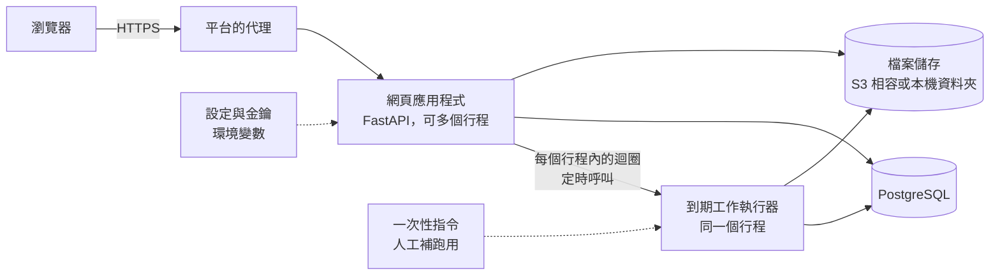
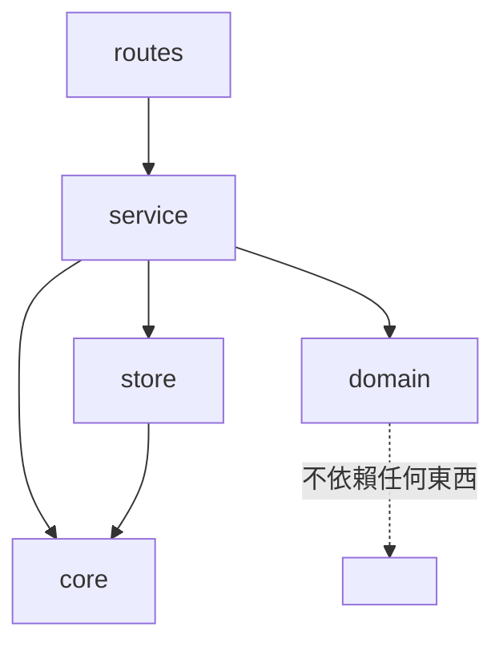
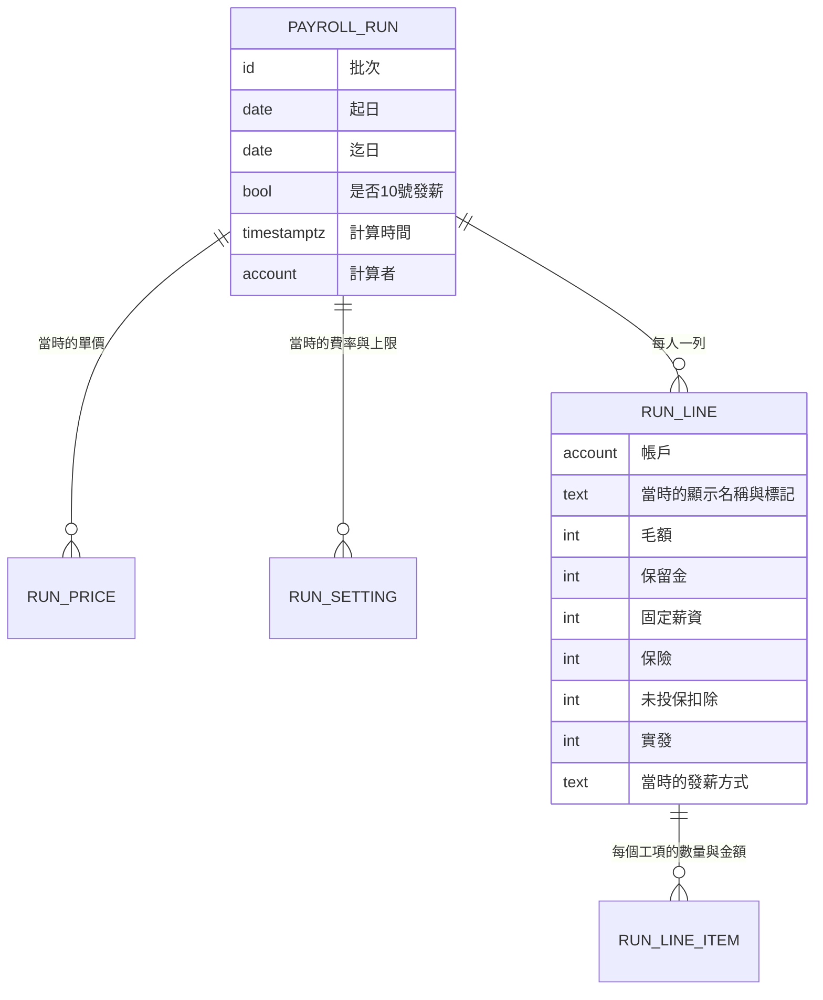

# 系統設計：員工日報系統重建

這份文件回答「這次要怎麼建、為什麼這樣建、另一種做法是什麼」。行為規格在
[`docs/spec/`](../../spec/index.md)；這裡只寫規格刻意不規定的部分：技術、結構、資料、
測試方式與部署。後續每個 task 會在自己的設計裡補上該領域的細節，但不得違反第 3、4、
5 節的共同約定；要違反時，先改這份文件並在 trail 記一列。

相關文件：[舊系統取捨](prior-systems.md)、[未決問題](open-questions.md)、
[後續 task 地圖](task-map.md)、[規格基準差異](spec-baseline-diff.md)、
風險試作紀錄在 [`spikes/`](spikes/)。

## 1. 一句話的形狀

一個 Python 網頁應用程式（伺服器端產生頁面），一個 PostgreSQL 資料庫，一個存檔案的
物件儲存；應用程式自己每隔幾十秒檢查一次有沒有到期的工作。本機與正式環境跑同一份
程式，只差設定。



## 2. 技術選擇

每一列都有另一個認真考慮過的選項與它的代價。

| 項目 | 選擇 | 理由 | 另一個選項與代價 |
| --- | --- | --- | --- |
| 語言與框架 | Python 3.12 以上、FastAPI | owner 最熟；v3 用它做到日報階段沒有遇到框架造成的問題 | TypeScript 全端（v2）：兩層之間的代理造成三個安全缺陷，owner 也較不熟 |
| 頁面 | 伺服器端 Jinja2 樣板，HTMX 做局部更新；HTMX 檔案放進 repo 並驗雜湊 | 只有一層，權限與驗證只寫一次；規格的畫面都是表單與清單 | 前後端分離的 SPA：同一條規則要在兩邊各寫一次，測試要多一層 |
| 資料庫 | PostgreSQL 16 以上，專屬的資料庫，不與任何既有專案共用 | 規格的並行規則需要列鎖與唯一約束；專屬資料庫省掉 v2、v3 一整套防護 | 與舊系統共用 Supabase 專案（v2、v3）：換來約 800 行的防護程式，卻沒用到任何 Supabase 功能 |
| 資料存取 | psycopg 3，直接寫 SQL，不用 ORM | 鎖定順序與交易邊界要看得見；v2、v3 得到相同結論 | SQLAlchemy ORM：樣板較少，但 `SELECT … FOR UPDATE` 的時機容易被藏起來 |
| Schema 變更 | 編號的純 SQL migration，只往前；允許 trigger 與約束 | 稽核不可改、庫存不變式交給資料庫保證 | 沿用 v3「禁止 trigger」：那條規則是為共用資料庫的掃描器而設，這次不需要 |
| 身分驗證 | 自己的帳戶表與存在資料庫的 session（只存憑證的雜湊）；密碼用 argon2id（`argon2-cffi`），參數是設定值 | 規格的登入是「從名單選名字加密碼」，還要鎖定、封存即失效（AD-13）；現成的身分服務對不上 | Supabase Auth：以 email 為主，鎖定與名單式登入都要繞路。標準庫 scrypt（v3）：少一個相依套件，但參數調校較不直觀 |
| CSRF | 每個 session 一個憑證，放在請求標頭，由共用版型統一加上 | v3 已驗證；各頁不會忘記 | 表單隱藏欄位：每個表單都要記得放 |
| 金額與數量 | 數量存整數 tenth；金額存整數元；需要小數的中間值用 `fractions.Fraction` 或 `Decimal`，自己實作 half-up | Python 的 `round()` 是銀行家捨入；float 是 v1 的缺陷來源 | 全程 `Decimal`：可行，但每個邊界都要指定捨入模式，容易漏 |
| 時間 | 唯一的時鐘物件，時區 Asia/Taipei；資料庫存 `timestamptz` | 規格大量依賴時間，測試要能設定時間 | 直接讀系統時間：鎖定 15 分鐘、23:59、跨年都無法測 |
| 檔案 | 一個儲存介面，三種實作：S3 相容（正式）、本機資料夾（開發與測試）、未設定。下載連結由應用程式簽發並檢查期限 | 規格要求剛好 3,600 秒的界線，只有用自己的時鐘才測得到；細節見第 7 節 | 物件儲存自己的預簽網址：下載不經過應用程式，但期限由對方的時鐘決定，界線無法測，稽核也寫不到實際開啟 |
| 排程 | 「現在哪些工作到期」是只看時鐘與已有紀錄的純邏輯；防重複靠資料庫的唯一索引；觸發是每個應用程式行程內的定時迴圈，另留一個一次性指令 | 晚到、重複、漏掉、多個行程都得到相同結果；見第 7 節 | 排程套件在固定時刻觸發（v1）：只能跑一個行程，23:59 當下若在重啟就漏掉。平台 cron：見 7.3 |
| Excel、PDF、Word | openpyxl、reportlab、python-docx；PDF 的中文字型檔隨應用程式一起部署，見第 7 節 | 三者都有現成的安裝檔，不需要額外的系統服務或字型套件 | 以 HTML 轉 PDF：版面好寫，但部署映像要多裝一整套排版引擎 |
| 測試 | pytest；規格的 feature 檔用 pytest-bdd 直接執行；瀏覽器冒煙測試用 Playwright | 規格就是測試；見第 6 節 | 另外手寫測試再對照規格：兩份會分岔（v1 的單元測試就是這樣失去意義） |

**認真考慮過的第二種整體形狀：** 以 Supabase 為中心（瀏覽器直接呼叫自動產生的資料
API，以資料列層級的權限政策把關，Supabase Auth 管登入）。它的程式最少，owner 也熟
Supabase。沒有採用，因為規格的核心規則（小組分配後保存份額、薪資批次快照、庫存
不變式、每個被拒絕的動作寫一筆稽核、拒絕時回報確切的中文訊息）都是跨多張表的
交易，寫成權限政策與資料庫函式之後，測試與除錯都比應用程式碼困難，而且每條規則
的「結果類別加訊息加沒有寫入」三斷言很難從政策層取得。

## 3. 程式的結構

依規格的領域切，不依技術層切。每個領域一個套件，領域之間只透過對方公開的函式
往來。

```text
app/
  core/        時鐘、資料庫連線與交易、拒絕出口、權限檢查、稽核寫入、session、
               設定、檔案儲存介面、到期工作執行器
  domain/      純函式：小組分配、薪資、保留金、現金面額、材料匯入比對。
               不碰資料庫、不讀時間，輸入輸出都是普通資料
  accounts/    身分與帳戶（IAM）
  reports/     日報（RPT）
  review/      審核（REV）
  payroll/     薪資（PAY）
  materials/   材料（MAT）
  ledger/      流水帳（LED）
  archives/    檔案庫（ARC）
  settings/    設定（CFG）
  audit/       稽核紀錄的查閱（AUD-F02）；寫入在 core
  main.py      組裝；自動載入各領域的路由，新增領域不必改它
migrations/    0001_….sql 起的純 SQL
tests/
  features → 指向 docs/spec（feature 檔只有一份）
  steps/common/   全部領域共用的步驟
  steps/<領域>/   各領域的步驟
  unit/           純函式的單元測試
  browser/        Playwright 冒煙測試
tools/         規格檢查等工具
```

每個領域套件內部固定三層：`routes`（讀請求、呼叫服務、產生頁面）、`service`（規則
與交易）、`store`（SQL）。規則只寫在 `service` 與 `domain`。

### 依賴方向



領域之間的依賴與規格的領域圖一致：日報依賴帳戶與設定，審核依賴日報，薪資依賴審核、
帳戶、設定，檔案庫依賴審核與薪資；材料與流水帳只依賴帳戶。反方向的呼叫不允許。

## 4. 共同約定

這幾個小元件是全部 31 個 feature 的地基，在「骨架與登入」task 一次做完，之後的 task
只使用、不修改；需要修改時算是設計變更。

| 約定 | 內容 | 保證了什麼 |
| --- | --- | --- |
| 拒絕出口 | 規則不成立時只有一種做法：丟出帶有「結果類別」與「訊息」的例外。它被統一轉成對應的 HTTP 狀態（401、403、422、409、423、429）與畫面上的訊息 | 規格的每個拒絕案例都能斷言類別與完整訊息 |
| 一個請求一個交易 | 服務函式在單一交易內完成；被拒絕時整個交易回復 | 「資料沒有任何變動」 |
| 權限檢查 | 每個動作開頭呼叫 `authorize(行為者, 動作, 對象)`，依角色、擁有權、狀態判斷；沒有明確允許就是拒絕 | AUD-R02；畫面藏起按鈕不算保護 |
| 稽核寫入 | 成功的動作：稽核列與資料變更在同一個交易。被 `FORBIDDEN` 拒絕：主交易回復後，用另一個交易只寫一列 `ACCESS_DENIED` | AUD-R03、AUD-R10 |
| 稽核不可改 | 應用程式的資料庫角色對稽核表只有新增與讀取的權限，另加 trigger 擋掉修改與刪除 | AUD-R13，不依賴應用程式自律 |
| 時鐘 | 程式只能從 `core` 的時鐘取得現在時間；有一個測試掃描原始碼，出現直接讀系統時間就失敗 | 時間相關的規則可測 |
| 鎖定順序 | 會同時發生的動作先鎖住同一列：日報的編輯、刪除、確認鎖該日報；每日 3 筆上限鎖提交者的帳戶列；材料審核鎖該材料列；工作執行靠唯一約束 | 規格 7 個 `@concurrency` scenario |
| 伺服器重新驗證 | 每個欄位都在伺服器依附錄 B 檢查；缺少的值不會被補成預設值 | v1 多個缺陷的根源 |
| 設定 | 全部來自環境變數，啟動時一次讀入並檢查；缺少必要設定就拒絕啟動，缺少選用設定（檔案儲存、加密金鑰）則進入規格定義的降級模式 | 本機與正式只差設定；IAM-R43、ARC-R06、LED-R07 |

## 5. 資料

### 5.1 每一份資料只有一個擁有者

| 資料 | 擁有的領域 | 其他領域怎麼用 |
| --- | --- | --- |
| 帳戶、角色、區域、大表旗標、封存狀態、密碼、鎖定、session | accounts | 透過 accounts 的函式查詢 |
| 每個人的薪資設定（固定薪資、保險、扣除比例、發薪方式、加密的銀行帳號、個人保留金費率與抵減） | accounts | payroll 在計算當下讀取，並把用到的值抄進批次 |
| 單價（三組）、區域扣除比例、保留金費率與上限 | settings | reports 不需要；payroll 在計算當下讀取並抄進批次 |
| 日報、明細、作業小組、自訂工項 | reports | review 透過 reports 的函式改狀態 |
| 份額 | review | payroll、檔案庫、統計只讀份額，不讀日報明細（REV-R11） |
| 薪資批次與其快照 | payroll | 匯出與檔案庫只讀批次 |
| 年度保留金的結算紀錄 | payroll | 無 |
| 材料、分頁、申請、暫存區 | materials | 無 |
| 流水帳紀錄與其證據檔的歷史 | ledger | 無 |
| 檔案庫紀錄 | archives | 無 |
| 稽核列 | core 寫入，audit 查閱 | 任何領域透過 `core` 寫入 |
| 檔案本體 | core 的儲存介面 | ledger 與 archives 只存「檔案鍵」，不存網址 |
| 到期工作的執行紀錄 | core | archives 與 accounts 登記自己的工作 |

### 5.2 兩個最難回頭的決定

規格 `definitions.md` 指出 AD-1 與 AD-4 在實作後才改的成本最高，所以在這裡定案。

**AD-4：舊日報永遠用送出當時的工項組。** 日報上有一個必填欄位記錄工項組（`WEST`、
`SOUTH`、`BIG_METER`），送出時由提交者當下的區域與大表旗標決定，之後不再改變。帳戶
改區只影響之後的新日報。計價、歷史的區域篩選、匯出欄位都讀這個欄位，不讀帳戶目前
的區域。v2 的 schema 已經這樣做，沿用。

**AD-1：算過的薪資不會因為後來改設定而改變。** 每次計算存成一個薪資批次，而且批次
自己帶著重現結果所需的一切：



- 批次與它的子表建立之後不可修改、不可刪除（與稽核表相同的保護方式）。再算一次是
  一個新批次（PAY-R13、PAY-R45）。
- 匯出（Excel、PDF、轉帳單、現金面額）只讀批次，不讀現行設定。
- 年度保留金的累計由「已確認的份額」加上「當年度的上限」即時算出，不由批次累加；
  批次只記錄當次算出的結果。這樣重算一個期間不會把保留金算兩次。跨年的期間依
  每筆日報的日期分年計算再相加（AD-3）。
- 轉帳單需要完整的銀行帳號：批次不存帳號，匯出當下以金鑰解密；金鑰不存在時轉帳單
  無法產生，其餘匯出照常。這一點規格沒有明寫，列為 Task 5 brief 要給 owner 決定的
  假設。

### 5.3 其他由資料庫保證的不變式

| 不變式 | 做法 |
| --- | --- |
| 只有一位 owner，owner 不能封存 | 部分唯一索引與檢查約束（沿用 v2） |
| 大表旗標只能在 USER 上 | 檢查約束 |
| 顯示名稱唯一 | 唯一約束 |
| 數量 0 至 9999 tenth | 檢查約束 |
| 作業小組最多 7 人、順序固定、不重複 | 順序欄位加唯一約束 |
| 自訂工項的名稱、數量、單價要嘛都有要嘛都沒有 | 檢查約束 |
| 庫存：累計領用加剩餘等於累計進貨，三者都不為負 | 檢查約束；暫存區的列另存，不受此約束 |
| 每種自動檔案庫每個日期最多一份 | 部分唯一索引（只限來源為自動的列） |
| 每個年度最多結算一次 | 唯一約束 |
| 同一張表單只送出一次 | 一次性憑證的唯一約束與期限（未決問題 OQ-8） |

「每人每日最多 3 筆自己的日報」不是唯一約束能表達的，由鎖住提交者的帳戶列後計數
來保證。

## 6. 規格怎麼變成自動測試

1. **feature 檔只有一份。** 測試直接執行 `docs/spec/<領域>/*.feature`，不複製。
2. **依規則開啟。** 一個清單檔列出已建置的規則 ID；不在清單上的規則，它的 scenario
   被標成「尚未建置」而不執行。每個 task 完成時，清單增加它建置的規則，領域索引把
   對應的 feature 從「尚未建置」移到「情境」。全部 137 條都在清單上時系統完成。
3. **共用步驟先設計。** 「結果是某個類別」「訊息是某字串」「沒有任何寫入」「寫了某種
   稽核列，除此之外沒有寫入」「某人已登入」「時鐘是某時刻」這幾類步驟，在骨架 task
   對著全部 31 個 feature 的用法一次設計完，之後視為公開介面。這是 v3 最大的教訓。
4. **「沒有任何寫入」的證明。** 動作前後各取一次全部資料表的快照比對。
5. **固定資料與字串從規格解析。** 共用背景取自 `docs/spec/background.md`，錯誤字串
   取自附錄 B；另有一個測試確認程式裡出現的每個錯誤字串都逐字存在於附錄 B。
6. **三個層級。** `@domain` 的規則直接對純函式；其餘在服務邊界以 HTTP 請求執行
   （同一行程，不開瀏覽器）；另外每個領域有少量 Playwright 冒煙測試走真的瀏覽器，
   專門抓「畫面沒有更新」這類請求層看不到的缺陷。
7. **並行要確定性。** `@concurrency` 的 scenario 用真的多個連線同時送出，數量足以
   讓「拿掉防護」每次都失敗；每個這類測試在建置時都要實際拿掉防護跑多次作為證據。
8. **速度。** 每個測試從一份已套好 migration 的範本資料庫複製出乾淨的資料庫，或在
   交易中執行後回復；測試環境的密碼雜湊用最低成本的參數。目標是全部 502 個例子在
   幾分鐘內跑完。
9. **薪資的回歸。** 標了 `@money` 的 scenario 每次都跑；PAY 的例子表另外用 v1 的公式
   獨立驗算一次（未決問題 OQ-16）。

## 7. 檔案、排程、金鑰與匯出

四個環節都先在本機試作過；做法、指令輸出與重現步驟在 `spikes/`。以下是定案的設計，
括號內是對應的試作紀錄。

### 7.1 檔案與會過期的連結（[`spikes/storage-and-links.md`](spikes/storage-and-links.md)）

- **一個儲存介面，只有放、取、刪三個動作**，三種實作：S3 相容（正式）、本機資料夾
  （開發與測試）、未設定。試作的同一組測試在本機資料夾與 S3 替身上都通過。
- **下載連結由應用程式簽發與檢查。** 連結是「檔案鍵加到期時間」的簽章，到期時間取自
  應用程式的時鐘；使用者點連結時由應用程式檢查後把檔案分塊轉送出去。連結不儲存，
  每次開啟都重新簽發（LED-R12、ARC-R05）。試作證明了 3,599 秒可開、3,600 秒失效。
- **沒有採用物件儲存自己的預簽網址。** 它的期限由對方的時鐘決定，測試無法控制；
  試作中的 S3 替身甚至完全不檢查期限（2 秒的網址 4 秒後仍可開）；本機資料夾也沒有
  對應的機制，會變成本機與正式跑不同的程式。
- **代價。** 每次下載都經過應用程式：流量算兩段，下載期間佔用一個工作執行緒。單檔
  上限 10 MB、使用者數百人，預期可接受，但沒有在正式環境實測。另外多一把簽章金鑰，
  多個行程要用同一把，換掉它會讓一小時內發出的連結失效。
- **憑證檔的類型以檔案開頭的位元組判斷**，不看副檔名與上傳者宣告的類型；回傳時用
  偵測到的類型並禁止瀏覽器自行猜測。10 MB 定義為 10,485,760 bytes。
- **取代檔案是新增一個新的儲存位置**，不覆蓋，所以舊檔仍可開啟（LED-R12 的最後一個
  scenario）。
- **未設定時**紀錄照常建立、沒有檔案，下載時提醒（ARC-R06、LED-R07）。
- **尚未證明：** 真實的 Supabase Storage 或 R2 端點、正式流量的成本、上傳前的請求
  大小上限、刪除檔案庫刪到一半失敗的處理。前兩項在 Task 9，後兩項在 Task 7。

### 7.2 銀行帳號加密（[`spikes/bank-number-encryption.md`](spikes/bank-number-encryption.md)）

- **AES-256-GCM**（`cryptography` 套件），金鑰來自設定。存下來的值帶有金鑰識別碼，
  並把帳戶的識別碼綁進驗證資料：之後可以換金鑰而不遺失資料，把甲的密文複製到乙的
  帳戶也解不開。試作涵蓋金鑰不存在、金鑰錯誤、六種密文損毀、金鑰輪替。
- **末四碼靠解密取得，不另外儲存。** 所以沒有金鑰時連末四碼也顯示「無法讀取」，
  與 IAM-R43 一致，資料庫裡也沒有任何一段明文。850 個帳戶全部解密約 2 毫秒。
- **沒有採用 Fernet。** 它不帶金鑰識別碼、會把系統時間寫進密文、也不能把密文綁定
  到帳戶。代價是約 30 行的格式處理要自己維護。
- **金鑰不存在時**：檢視顯示「無法讀取」，修改以 `BLOCKED` 拒絕並顯示規格的訊息，
  其他功能照常。
- **超出規格的一點（未決問題 OQ-20）：** 金鑰錯誤或密文損毀時，試作同樣拒絕修改，
  因為金鑰設錯通常可以改回來，直接覆寫會毀掉還救得回的資料；代價是真的損毀的那
  一筆需要管理員另外的動作才能清除。
- **尚未證明：** 在真正的資料表上輪替金鑰的流程、金鑰的保管與備份。前者在 Task 4，
  後者在 Task 9 的維運說明。

### 7.3 排程工作（[`spikes/scheduled-jobs.md`](spikes/scheduled-jobs.md)）

- **「到期」是狀態，不是事件。** 一個純函式只看現在的時刻與每種檔案庫最後一份自動
  紀錄的日期，回答「現在該補哪幾份」。所以觸發晚到、重複、漏掉，結果都一樣；測試
  只需要設定時鐘。試作涵蓋 23:59 前一秒不到期、台北時區、2026-11-30、2027-02-28、
  2028-02-29，以及停機數日後由舊到新逐日補做。
- **防重複交給資料庫。** 自動檔案庫在（類型、日期）上有部分唯一索引，寫入時衝突就
  略過；紀錄與它的內容在同一個交易，建到一半當掉不會留下半成品。試作強制兩個交易
  重疊：拿掉索引後 20 次執行 20 次都產生兩份，有索引時永遠一份（ARC-R03）。
- **觸發是每個應用程式行程內的迴圈**（預設 30 秒一次，設定值 `TICK_SECONDS`），
  每次呼叫同一個 `tick`：補做到期的檔案庫，並清除過期的 session。迴圈中的錯誤不會
  讓它停下來。另外保留一個一次性指令呼叫同一個 `tick`，給人工補跑使用。
- **這與設計初稿不同。** 初稿用平台的 cron 每分鐘執行指令；試作顯示兩者的正確性
  都來自同一個唯一索引，而平台 cron 多一個要部署的服務、本機沒有對應的東西、時間
  以 UTC 設定且不保證準時。因此改採行程內迴圈；日後要改用平台 cron 只需要把
  `TICK_SECONDS` 設為 0（關閉迴圈）並排程那個一次性指令，程式不變。
- **代價與前提。** 沒有任何行程醒著時不會歸檔，醒來後的第一次 `tick` 會補做。所以
  正式環境必須關閉平台「沒有流量就暫停」的功能，或加上平台 cron。
- **試作時先選、需要 owner 確認的預設**（未決問題 OQ-21 至 OQ-23）：補做的檔案庫
  收錄什麼時間點的資料、全新安裝是否建立第一份、被刪除的自動檔案庫是否重建。
- **尚未證明：** 真實平台上行程是否會被暫停、經過連線池時的行為、真實內容的產生
  時間（產生期間另一個行程會等在同一個鍵上）。都在 Task 9。試作中「兩個真的伺服器
  行程加重啟」的測試在拿掉防護後仍然通過，所以它不是防護的證明；證明是上面那個
  強制重疊的交易測試。

### 7.4 PDF 與 Word（[`spikes/pdf-and-word-exports.md`](spikes/pdf-and-word-exports.md)）

- **PDF 用 reportlab，中文字型檔放在應用程式裡一起進版控與部署**：Noto Sans TC
  Regular，授權 SIL OFL 1.1，7.1 MB。部署映像不需要安裝任何字型套件；本機、測試、
  正式產生的 PDF 用同一個字型檔。試作把產生的 PDF 讀回文字，確認中文姓名與帶千分位
  的金額都在，頁面是 A4 橫式，字型內嵌於檔案。
- **v1 的做法行不通。** reportlab 無法載入 `fonts-noto-cjk` 系統套件的字型；它內建的
  中文字型不內嵌於檔案，換一台機器就可能顯示不出來。
- **Word 用 python-docx**，每段文字指定東亞字型（標楷體）。Word 檔本來就不內嵌
  字型，伺服器不需要任何字型。試作把檔案讀回文字並檢查原始 XML。
- **金額格式集中在一個函式**：千分位，負數加負號並以紅色顯示（附錄 D）。製表時間
  由時鐘傳入。兩個產生函式都只回傳位元組，不碰檔案系統與資料庫。
- **代價。** repo 與映像各多 7.1 MB（只有一種字重；要粗體得再放一個約 7 MB 的檔案，
  試作以底色區分表頭）。
- **需要 owner 確認的事**（未決問題 OQ-15、OQ-24）：轉帳單的版面是依 v1 推測重現的，
  必須對照真實的銀行表單；姓名用到字型沒有的字時，reportlab 會無聲地印出空格。
- **尚未證明：** 在真正的 Microsoft Word 開啟轉帳單（試作只用 LibreOffice 轉換後
  讀回）；銀行是否接受這個檔案。

## 8. 一個情境從頭走到尾

「員工送出日報，管理員確認，之後計薪」經過的每一站：

1. 員工打開日報頁。`reports` 依他的區域與大表旗標列出工項組，並發出一次性的送出
   憑證。
2. 員工送出。`routes` 讀表單；`service` 開交易，`authorize` 檢查他是未封存的
   `USER`；依固定順序驗證日期、數量、至少一個工項、共同作業者；鎖住他的帳戶列，數
   當天自己的日報是否少於 3 筆；寫入日報（記下工項組）、明細、作業小組；寫一列
   `REPORT_CREATE`（含「共 N 人作業」）；提交。任何一步不成立就丟出拒絕，交易回復。
3. 管理員在確認頁勾選後批次確認。`review` 對每一筆各自處理：鎖住該日報，仍是
   `PENDING` 才繼續；呼叫 `domain` 的小組分配（整數 tenth，餘數先給提交者再依小組
   順序），把每人每工項的份額存起來；狀態改為 `CONFIRMED`；寫 `REPORT_CONFIRM`。
4. 管理員計薪。`payroll` 讀期間內的份額、每筆日報記下的工項組、當下的單價與費率、
   每人的薪資設定；單價不完整就以 `BLOCKED` 拒絕；呼叫 `domain` 的薪資與保留金函式；
   把結果連同用到的單價、費率、上限存成一個不可變的批次。
5. 管理員匯出。Excel、PDF、轉帳單、現金面額都只讀該批次；每次匯出寫一列 `EXPORT`。
6. 當天 23:59，到期工作執行器建立當日的檔案庫紀錄，產生 Excel 存進檔案儲存，行為者
   是 `SYSTEM`。

## 9. 部署

### 9.1 每個部分跑在哪裡

建議的組合，以及換掉其中一項的代價。供應商的方案內容與價格會變動，Task 9 開始時要
以當時的官方文件重新確認；設計本身不綁定任何一家。

| 部分 | 建議 | 為什麼 | 另一個選項與代價 |
| --- | --- | --- | --- |
| 網頁應用程式 | Railway 上的一個服務，由 repo 的 Dockerfile 建置 | owner 熟悉；v1 就在上面 | 其他容器平台：設計不變，只換部署步驟 |
| 排程觸發 | 網頁服務每個行程內的迴圈（7.3）；平台「沒有流量就暫停」的功能要關閉 | 不需要第二個服務；本機與正式是同一段程式 | 平台的 cron 定時執行一次性指令：行程可以休眠，但多一個服務，且時間以 UTC 設定、不保證準時 |
| 資料庫 | Supabase 上一個專屬的 PostgreSQL 專案，只當資料庫用 | owner 熟悉；有受管的備份 | Railway 的 PostgreSQL：少一家供應商，但備份與還原要自己安排 |
| 檔案 | S3 相容的物件儲存：Supabase Storage 的 S3 相容端點，或 Cloudflare R2（v1 用它） | 儲存介面只用 S3 的基本操作，兩者皆可 | Railway 的磁碟區加本機資料夾實作：不需要物件儲存，但磁碟區綁定單一服務、備份要自己做 |
| 金鑰與設定 | 平台的環境變數 | 不進 repo | 專門的金鑰管理服務：對這個規模過重 |

應用程式不使用 Supabase 的 Auth、資料 API 或資料列權限；資料庫連線字串是它與
Supabase 唯一的接點。因此日後換到任何 PostgreSQL 都只是改一個設定。

### 9.2 owner 需要準備的東西

| 項目 | 用途 |
| --- | --- |
| Railway 專案 | 跑網頁服務（到期工作在同一個服務的行程內執行） |
| Supabase 專案（新的、專屬的） | 資料庫；若檔案也放這裡，另需一個儲存桶與 S3 存取金鑰 |
| 網域（選用） | 平台會給預設網址 |
| 銀行帳號加密金鑰 | 由 owner 產生並自己保管一份；遺失就無法讀回已存的銀行帳號 |
| 連結簽章金鑰 | 由 owner 產生；可以輪替，輪替後已發出的下載連結會失效 |
| 第一位 owner 的密碼 | 首次上線時當場輸入 |

### 9.3 設定一覽

名稱由 `skeleton-and-sign-in` task 定案（見該 task 的設計第 2 節）。沒有標「選用」、
也沒有預設值的，缺了就拒絕啟動。登入憑證與防偽造憑證都是存在資料庫的隨機值，
不需要簽章金鑰，所以沒有 session 金鑰這一項。

| 設定 | 內容 | 缺少時 |
| --- | --- | --- |
| `DATABASE_URL` | PostgreSQL 連線字串 | 拒絕啟動 |
| `APP_ENV` | `production` 時 cookie 只走 HTTPS，並拒絕測試專用的弱參數 | 預設為開發模式 |
| `PASSWORD_HASH_PROFILE` | 密碼雜湊的成本：`standard` 或測試用的 `fast` | 預設 `standard`；正式環境拒絕 `fast` |
| `CLOCK_OFFSET_MINUTES` | 把時鐘往後撥，手動試逾時用 | 預設 0；正式環境不為 0 時拒絕啟動 |
| `LINK_SIGNING_KEY` | 下載連結的簽章；由流水帳與檔案庫的 task 加入 | 設了檔案儲存卻沒有它時拒絕啟動 |
| `BANK_KEY`、`BANK_KEY_ID`（選用） | 銀行帳號加密金鑰與它的識別碼 | 銀行帳號顯示「無法讀取」、不能修改，其他功能照常（IAM-R43） |
| `STORAGE_*`（選用） | 儲存種類、端點、儲存桶、存取金鑰；或本機資料夾路徑 | 紀錄照常建立但沒有檔案，下載時提醒（ARC-R06、LED-R07） |
| `TICK_SECONDS` | 到期工作迴圈的間隔秒數；0 表示關閉迴圈（改由外部排程呼叫一次性指令） | 預設 30 |
| `TRUSTED_PROXY_HOPS` | 信任幾層代理加上的來源位址，本機 0、平台 1 | 預設 0 |

### 9.4 首次上線

1. owner 建立 Railway 與 Supabase 專案，把 9.3 的設定填進 Railway。
2. 部署。服務啟動前先執行 migration 指令；失敗就不啟動新版本。
3. 執行一次性的指令建立 owner 帳戶並載入預設資料（工項單價、費率、材料）。這個
   指令在已有 owner 時拒絕執行。
4. 打開網址，用 owner 登入，確認健康檢查頁顯示資料庫、檔案儲存、金鑰三者的狀態。

### 9.5 之後的更新與退回

- 合併到 `main` 之後由平台自動部署，或由 owner 手動觸發；這一點在 Task 9 由 owner
  決定。
- Migration 只往前，而且每次都要讓「上一版的程式」還能在新的 schema 上運作：先加
  新的、兩版都能跑，下一版再移除舊的。因此退回只需要在平台上把服務切回上一個
  映像，不需要還原資料庫。
- 不能這樣拆的 schema 變更（極少）要在該 task 的報告裡明寫退回步驟。

### 9.6 備份與最壞的情況

| 東西 | 備份 | 最壞情況 |
| --- | --- | --- |
| 資料庫 | 受管服務的每日備份；另外每月由檔案庫產生的月報是一份人看得懂的副本 | 遺失最近一次備份之後的日報與確認；薪資批次若在其中，要依日報重算 |
| 檔案 | 物件儲存本身的耐久性；證據檔永久保存，不設自動清除 | 檔案遺失時紀錄仍在，下載時提醒 |
| 加密金鑰 | owner 自己保管 | 遺失後已存的銀行帳號無法讀回，要重新輸入；不影響其他功能 |

備份的還原要在 Task 9 實際演練一次，而不是只寫在文件裡。

### 9.7 本機與正式的差別

差別全部是設定，沒有例外：每一項都列在 9.3。本機與正式會不同的是資料庫連線、
檔案儲存的種類與它的存取金鑰、各把金鑰的值、`APP_ENV`、信任的代理層數
（`TRUSTED_PROXY_HOPS`，本機 0、平台 1）。排程在本機與正式都是同一個行程內迴圈。
沒有任何「如果是正式環境就走另一段程式」的分支，除了由 `APP_ENV` 控制的三個檢查：
cookie 的安全旗標、拒絕測試專用的弱參數、拒絕撥動時鐘。

## 10. brief 的每個情境落在哪裡

| 情境 | 交付物 | 怎麼證明 |
| --- | --- | --- |
| S-1 規格基準可單獨閱讀 | `docs/spec/` | 人工對照；`tools/check_spec.py` 確認 31 個 feature 都被索引連結 |
| S-2 差異都有來源 | `spec-baseline-diff.md` | 文件內附的 `diff` 指令與預期輸出 |
| S-3 例子可被工具讀取 | `tools/check_spec.py` | 執行；已看過它在總數錯誤、scenario 同名、語法錯誤時失敗 |
| S-4 取捨紀錄 | `prior-systems.md` | 人工對照 |
| S-5 設計回答了問題 | 本文件第 2 至 8 節 | 人工對照 |
| S-6 四個環節試過 | `spikes/` 四份紀錄與兩個 `spike/` 分支 | 照紀錄的步驟重跑 |
| S-7 未決問題有預設 | `open-questions.md` | 人工對照 |
| S-8 task 地圖 | `task-map.md` | 人工對照；31 個 feature 各出現一次 |
| S-9 部署設計 | 本文件第 9 節 | 人工對照 |
