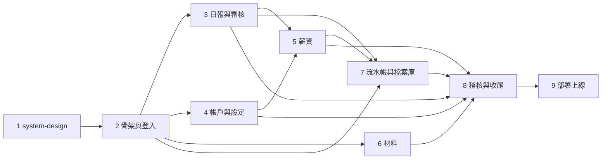

# 後續 task 地圖

整個系統分成 9 個 task。`system-design` 是第 1 個；第 2 至 8 個建置全部 31 個 feature；
第 9 個把成品部署上線。每個 feature 屬於一個 task，只有 `AUD-F01` 例外：它的權限總表
（AUD-R02）與拒絕紀錄（AUD-R03）要等其他領域的動作存在才驗得了，所以 owner 在核准
`skeleton-and-sign-in` 的 brief 時同意把它拆成兩段（Task 2 與 Task 8）。每個 task 都會
先有自己的 brief 讓 owner 核准，這張地圖只定範圍與順序。

## 順序與並行

- Task 3、4、6 互不依賴，Task 2 合併後可以同時進行。
- Task 7 的流水帳部分只依賴 Task 2；檔案庫需要已確認的日報（Task 3）與薪資摘要
  （Task 5），所以整個 Task 7 排在 Task 5 之後。若想提早，可以把流水帳拆出來與
  Task 3、4、6 並行。
- 同時進行的 task 會各自新增 migration 與「已建置規則」清單的內容；後合併的那個
  要先併入 `main` 再送驗證。

## 總表

| # | Task | 涵蓋 | 依賴 |
| --- | --- | --- | --- |
| 1 | system-design | 設計，沒有 feature | 無 |
| 2 | 骨架與登入（`skeleton-and-sign-in`） | IAM-F01 至 F03；AUD-F01 的 AUD-R01 | 1 |
| 3 | 日報與審核（`reports-and-review`） | RPT-F01 至 F03、REV-F01 至 F03 | 2 |
| 4 | 帳戶與設定（`accounts-and-settings`） | IAM-F04 至 F07、CFG-F01、CFG-F02 | 2 |
| 5 | 薪資（`payroll`） | PAY-F01 至 F07 | 3、4 |
| 6 | 材料（`materials`） | MAT-F01 至 F04 | 2 |
| 7 | 流水帳與檔案庫（`ledger-and-archives`） | LED-F01、LED-F02、ARC-F01 | 2；ARC-F01 另需 3 與 5 |
| 8 | 稽核與收尾（`audit-and-wrap-up`） | AUD-F02；AUD-F01 的 AUD-R02、AUD-R03 | 2 至 7 |
| 9 | 部署上線（`deployment`） | 沒有 feature | 8；需要 owner 的帳號與金鑰 |

每個 task 的規則、scenario 與例子數量列在下面各節的表裡；`tools/check_spec.py` 會
確認每個 feature 在這份文件裡的數字加起來等於 feature 檔的實際數量。全系統的總數只
寫在 [`docs/spec/index.md`](../../spec/index.md)。

## 各 task 的內容

### Task 2：骨架與登入（`skeleton-and-sign-in`）

依賴：1。

| Feature | 規則 | Scenario | 例子 |
| --- | --- | --- | --- |
| [IAM-F01 登入](../../spec/accounts/IAM-F01-sign-in.feature) | 3 | 4 | 10 |
| [IAM-F02 登入鎖定與頻率限制](../../spec/accounts/IAM-F02-sign-in-lockout-and-rate-limit.feature) | 4 | 7 | 10 |
| [IAM-F03 Session 與登出](../../spec/accounts/IAM-F03-session-and-sign-out.feature) | 3 | 8 | 9 |
| [AUD-F01 每個動作都重新檢查權限](../../spec/audit/AUD-F01-authorization-on-every-action.feature)（只含 AUD-R01） | 1 | 1 | 1 |

feature 以外要交付的：可部署的骨架（Dockerfile、migration 指令、健康檢查頁、設定檢查）；第 4 節全部的共同約定；第 6 節的測試骨架與共用步驟；建立 `try-<app>` skill；CI 工作流程（需要 owner 加入，因為在 `.github/` 下）。

brief 要帶給 owner 決定的未決問題：OQ-3、OQ-9、OQ-17、OQ-18。

### Task 3：日報與審核（`reports-and-review`）

依賴：2。

| Feature | 規則 | Scenario | 例子 |
| --- | --- | --- | --- |
| [RPT-F01 送出日報](../../spec/reports/RPT-F01-submit-a-daily-report.feature) | 8 | 17 | 35 |
| [RPT-F02 回報生命週期](../../spec/reports/RPT-F02-report-lifecycle.feature) | 5 | 9 | 15 |
| [RPT-F03 歷史與匯出](../../spec/reports/RPT-F03-history-and-export.feature) | 5 | 9 | 15 |
| [REV-F01 確認或駁回回報](../../spec/review/REV-F01-confirm-or-reject-reports.feature) | 3 | 5 | 5 |
| [REV-F02 小組分配與份額保存](../../spec/review/REV-F02-crew-split-and-stored-shares.feature) | 2 | 6 | 14 |
| [REV-F03 自訂工項](../../spec/review/REV-F03-custom-work-item.feature) | 5 | 7 | 13 |

feature 以外要交付的：小組分配的純函式；日報與確認的列鎖與競態測試；歷史的分頁；Excel 匯出的共用寫法。

brief 要帶給 owner 決定的未決問題：OQ-1、OQ-2、OQ-4、OQ-5、OQ-6、OQ-7、OQ-8、OQ-11、OQ-12。

### Task 4：帳戶與設定（`accounts-and-settings`）

依賴：2。

| Feature | 規則 | Scenario | 例子 |
| --- | --- | --- | --- |
| [IAM-F04 帳戶生命週期與薪資設定](../../spec/accounts/IAM-F04-account-lifecycle-and-pay-settings.feature) | 7 | 16 | 39 |
| [IAM-F05 Owner 管理管理員](../../spec/accounts/IAM-F05-owner-manages-administrators.feature) | 3 | 6 | 11 |
| [IAM-F06 密碼變更與重設](../../spec/accounts/IAM-F06-password-change-and-reset.feature) | 3 | 5 | 10 |
| [IAM-F07 銀行帳號遮罩與顯示](../../spec/accounts/IAM-F07-bank-number-masking-and-reveal.feature) | 4 | 7 | 14 |
| [CFG-F01 單價](../../spec/settings/CFG-F01-unit-prices.feature) | 4 | 5 | 9 |
| [CFG-F02 費率](../../spec/settings/CFG-F02-rates.feature) | 4 | 6 | 15 |

feature 以外要交付的：銀行帳號加密（依 T-01 的試作）；預設單價與費率的種子資料。

brief 要帶給 owner 決定的未決問題：OQ-20。

### Task 5：薪資（`payroll`）

依賴：3、4。

| Feature | 規則 | Scenario | 例子 |
| --- | --- | --- | --- |
| [PAY-F01 毛額、淨額與實發](../../spec/payroll/PAY-F01-gross-net-and-final-pay.feature) | 6 | 13 | 25 |
| [PAY-F02 保留金與年度上限](../../spec/payroll/PAY-F02-retention-and-annual-cap.feature) | 5 | 12 | 29 |
| [PAY-F03 封存帳戶的薪資](../../spec/payroll/PAY-F03-archived-accounts-in-payroll.feature) | 3 | 7 | 10 |
| [PAY-F04 年度結算](../../spec/payroll/PAY-F04-year-end-settlement.feature) | 4 | 4 | 7 |
| [PAY-F05 薪資批次、匯出與現金面額](../../spec/payroll/PAY-F05-payroll-runs-exports-and-cash-breakdown.feature) | 6 | 13 | 20 |
| [PAY-F06 個人統計與薪資試算](../../spec/payroll/PAY-F06-personal-statistics-and-salary-trial.feature) | 4 | 7 | 10 |
| [PAY-F07 跨帳戶統計總表](../../spec/payroll/PAY-F07-cross-account-summary.feature) | 3 | 4 | 5 |

feature 以外要交付的：薪資、保留金、現金面額的純函式；薪資批次的不可變保護；PDF 與轉帳單（依 T-02 的試作）。

brief 要帶給 owner 決定的未決問題：OQ-15、OQ-16、OQ-24；轉帳單在金鑰不存在時的行為（設計 5.2）。

### Task 6：材料（`materials`）

依賴：2。

| Feature | 規則 | Scenario | 例子 |
| --- | --- | --- | --- |
| [MAT-F01 申請材料](../../spec/materials/MAT-F01-request-materials.feature) | 5 | 9 | 22 |
| [MAT-F02 審核材料申請](../../spec/materials/MAT-F02-review-material-requests.feature) | 4 | 7 | 12 |
| [MAT-F03 庫存匯入與暫存區](../../spec/materials/MAT-F03-inventory-import-and-quarantine.feature) | 2 | 6 | 15 |
| [MAT-F04 庫存管理](../../spec/materials/MAT-F04-inventory-administration.feature) | 8 | 14 | 26 |

feature 以外要交付的：匯入比對的純函式；庫存不變式的資料庫約束；材料種子資料。

brief 要帶給 owner 決定的未決問題：OQ-14。

### Task 7：流水帳與檔案庫（`ledger-and-archives`）

依賴：2；ARC-F01 另需 3 與 5。

| Feature | 規則 | Scenario | 例子 |
| --- | --- | --- | --- |
| [LED-F01 流水帳紀錄與餘額](../../spec/ledger/LED-F01-ledger-entries-and-balances.feature) | 6 | 10 | 23 |
| [LED-F02 證據檔與作廢](../../spec/ledger/LED-F02-evidence-files-and-voiding.feature) | 4 | 8 | 15 |
| [ARC-F01 日月報檔案庫](../../spec/archives/ARC-F01-scheduled-and-manual-archives.feature) | 6 | 11 | 13 |

feature 以外要交付的：檔案儲存介面與會過期的連結（依 T-01）；到期工作執行器與每日、每月歸檔（依 T-02）；過期 session 的清除。

brief 要帶給 owner 決定的未決問題：OQ-21、OQ-22、OQ-23。

### Task 8：稽核與收尾（`audit-and-wrap-up`）

依賴：2 至 7。

| Feature | 規則 | Scenario | 例子 |
| --- | --- | --- | --- |
| [AUD-F02 稽核軌跡](../../spec/audit/AUD-F02-audit-trail.feature) | 5 | 9 | 24 |
| [AUD-F01 每個動作都重新檢查權限](../../spec/audit/AUD-F01-authorization-on-every-action.feature)（AUD-R02、AUD-R03） | 2 | 2 | 21 |

feature 以外要交付的：稽核紀錄的查閱頁；權限總表的逐格測試；附錄 D 的檢查清單（分頁、顏色、導覽、回饋）；負載測試；全部 137 條規則都在已建置清單上。

brief 要帶給 owner 決定的未決問題：OQ-10、OQ-13。

### Task 9：部署上線（`deployment`）

依賴：Task 8；需要 owner 提供 Railway 與 Supabase 的帳號、金鑰與第一位 owner 的密碼。

沒有新的 feature。交付：依設計第 9 節完成正式環境的設定、首次上線、一次備份還原
演練、一次版本退回演練，以及給 owner 的維運說明（金鑰保管與輪替、更新、退回）。

brief 要帶給 owner 決定的未決問題：OQ-17、OQ-19（是否需要搬移舊系統的資料；需要
的話另開一個 task 排在這之前），以及合併後自動部署或手動部署。

因為部署是不能在本機驗證、也不能由 agent 自行執行的動作，這個 task 的每一步都由
owner 執行或當場核准；agent 準備指令與檢查清單。

## 規模的提醒

Task 3、4 與 5 最大（各約 100 個例子）。若照設定檔預設的預算（4 小時、12 個
session）不夠，建議在它們的 brief 裡把預算調高，或把 Task 5 拆成「計算與批次」
（PAY-F01 至 F04）與「匯出與統計」（PAY-F05 至 F07）。
